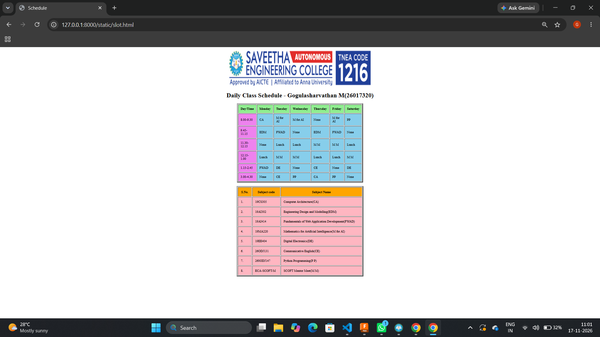

# Ex04 Time Table
## Date: 17-11-2026

## AIM
To write a html webpage page to display your slot timetable.

## ALGORITHM
### STEP 1
Create a Django-admin Interface.

### STEP 2
Create an App inside the Django project.

### STEP 2
Create a static folder uder the created App and insert HTML code.

### STEP 3
Create a simple table using ```<table>``` tag in html with the relevant attributes.

### STEP 4
Add rows using ```<tr>``` tag.

### STEP 5
Add your course schedule using ```<td>``` tag.

### STEP 6
Execute the program using runserver command.

## PROGRAM
```
<html>
    <head> 
        <title> Schedule </title> 
    </head>
    <body>
        <center>
        
            <h1>Daily Class Schedule - Gogulasharvathan M(26017320)</h1>
        </center>

        <table border="6"
        cellspacing="3" 
        cellpadding="12"
        align="center" width="500" height="250">
            <thead bgcolor="lightgreen">
                <tr>
                    <th>Day/Time</th>
                    <th>Monday</th>
                    <th>Tuesday</th>
                    <th>Wednesday</th>
                    <th>Thursday</th>
                    <th>Friday</th>
                    <th>Saturday</th>
                </tr>
            </thead>
            <tbody bgcolor="skyblue">
                <tr>
                    <td bgcolor="violet">8.00-9.30</td>
                    <td>CA</td>
                    <td>M for AI</td>
                    <td>M for AI</td>
                    <td>None</td>
                    <td>M for AI</td>
                    <td>PP</td>
                </tr>
                <tr>
                    <td bgcolor="violet">9.45-11.15</td>
                    <td>EDM</td>
                    <td>FWAD</td>
                    <td>None</td>
                    <td>EDM</td>
                    <td>FWAD</td>
                    <td>None</td>
                </tr>
                <tr>
                    <td bgcolor="violet">11.30-12.15</td>
                    <td>None</td>
                    <td>Lunch</td>
                    <td>Lunch</td>
                    <td>M M</td>
                    <td>M M</td>
                    <td>Lunch</td>
                </tr>
                <tr>
                    <td bgcolor="violet">12.15-1.00</td>
                    <td>Lunch</td>
                    <td>M M</td>
                    <td>M M</td>
                    <td>Lunch</td>
                    <td>Lunch</td>
                    <td>M M</td>
                </tr>
                <tr>
                    <td bgcolor="violet">1.15-2.45</td>
                    <td>FWAD</td>
                    <td>DE</td>
                    <td>None</td>
                    <td>CE</td>
                    <td>None</td>
                    <td>DE</td>
                </tr>
                <tr>
                    <td bgcolor="violet">3.00-4.30</td>
                    <td>None</td>
                    <td>CE</td>
                    <td>PP</td>
                    <td>CA</td>
                    <td>PP</td>
                    <td>None</td>
                </tr>
            </tbody>
        </table>
        <br>
        <table border="6"
        cellspacing="3"
        cellpadding="14"
        align="center" width="650" height="250">
            <thead bgcolor="orange">
                <tr>
                    <th>S.No.</th>
                    <th>Subject code</th>
                    <th>Subject Name</th>
                </tr>
            </thead>
            <tbody bgcolor="lightpink">
                <tr>
                    <td>1.</td>
                    <td>19CS305</td>
                    <td>Computer Architecture(CA)</td>
                </tr>
                <tr>
                    <td>2.</td>
                    <td>19AI302</td>
                    <td>Engineering Design and Modelling(EDM)</td>
                </tr>
                <tr>
                    <td>3.</td>
                    <td>19AI414</td>
                    <td>Fundamentals of Web Application Development(FWAD)</td>
                </tr>
                <tr>
                    <td>4.</td>
                    <td>19MA220</td>
                    <td>Mathematics for Artificial Intelligence(M for AI)</td>
                </tr>
                <tr>
                    <td>5.</td>
                    <td>19EE404</td>
                    <td>Digital Electronics(DE)</td>
                </tr>
                <tr>
                    <td>6.</td>
                    <td>26ODJ131</td>
                    <td>Communicative English(CE)</td>
                </tr>
                <tr>
                    <td>7.</td>
                    <td>260ODJ147</td>
                    <td>Python Programming(P P)</td>
                </tr>
                <tr>
                    <td>8.</td>
                    <td>ECA-SCOFT-M</td>
                    <td>SCOFT Mentor Meet(M M)</td>
                </tr>
            </tbody>
        </table>
    </body>
</html>
```

## OUTPUT
Webpage


## RESULT
The program for creating slot timetable using basic HTML tags is executed successfully.
